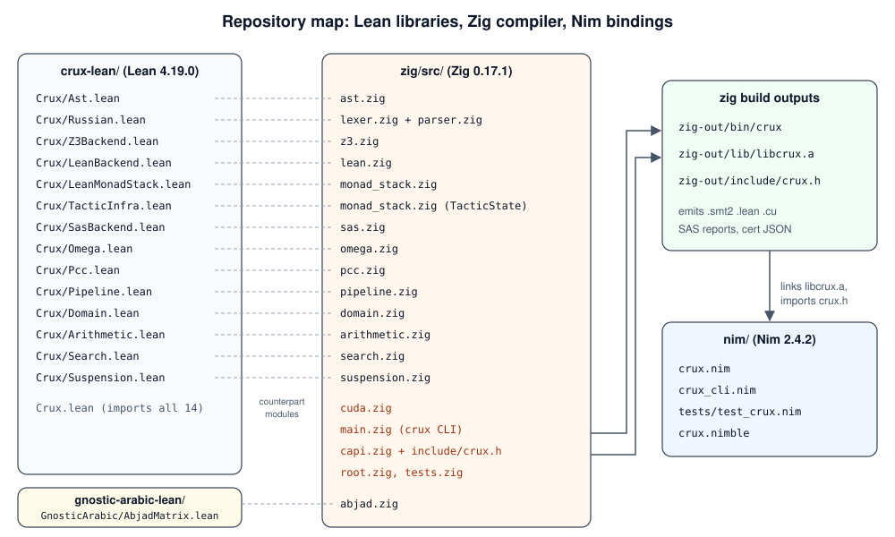
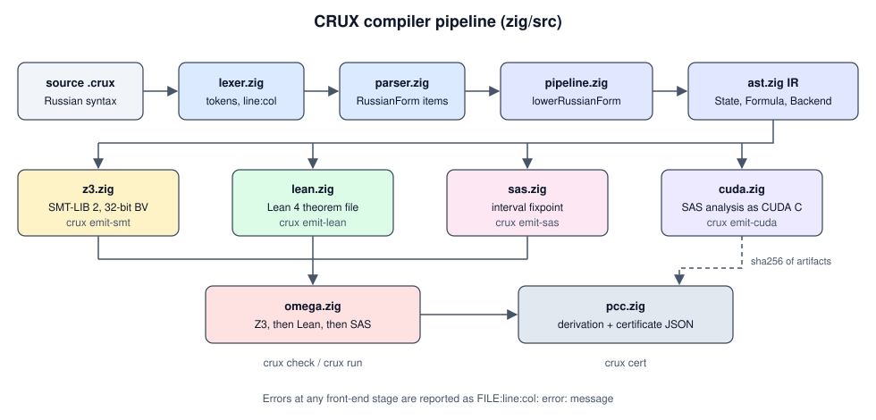
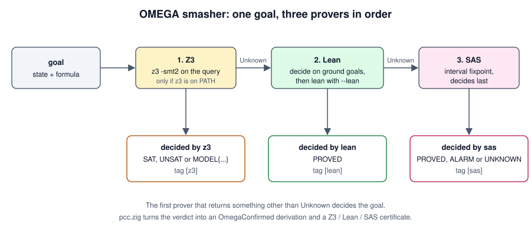
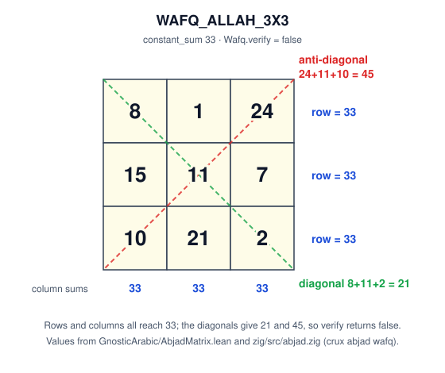

<!-- SPDX-License-Identifier: AGPL-3.0-only OR LicenseRef-SnapKitty-Opaque-1.0 -->
<!-- Copyright (C) 2026 Ahmad Ali Parr / SnapKitty Research Lab -->

# crux-gnostic-lean

[](https://github.com/AHMADALIPARR/crux-gnostic-lean/actions/workflows/ci.yml)
[](LICENSE)


CRUX is a small verification language written in Russian keywords. A CRUX file states facts about recursive program states (`сила(S0[x := 2 + 3], x = 5)`), and the toolchain sends each one to three provers in a fixed order: Z3, then Lean, then a SAS abstract interpreter. The verdict comes back with a proof-carrying certificate.

This repository holds the CRUX model in three forms, plus an Abjad library:

- **`crux-lean/`**: the CRUX / SILA / OMEGA-SMASHER stack as a Lean 4 library.
- **`zig/`**: a standalone CRUX compiler in Zig. It parses `.crux` files and emits SMT-LIB 2, Lean 4, SAS reports, CUDA C and certificates.
- **`nim/`**: Nim bindings over `libcrux`, the compiler's C ABI.
- **`gnostic-arabic-lean/`**: the Abjad matrix in Lean 4. It covers the twenty-eight Arabic letters and their values, the 3×3 Allah wafq, decoherence quadrants and the Al-Hamid matrix. `zig/src/abjad.zig` ports it to Zig.



## Features

- **Russian-syntax front end.** It parses the twelve CRUX forms (`равенство`, `импликация`, …, `доказательство`), quantifiers, fixpoints, recursive states and `S[x := t]` bindings. Errors are reported as `FILE:line:col: error: message`.
- **Four backends from one IR:**
  - SMT-LIB 2 over 32-bit bit-vectors for Z3;
  - core Lean 4 theorems, with no Mathlib;
  - an interval-domain SAS fixpoint report;
  - the same SAS analysis lowered to CUDA C, which also builds as plain C++.
- **OMEGA smasher.** Z3, Lean and SAS run in priority order, and the first definite answer decides the goal.
- **Proof-carrying certificates.** Each verdict becomes a derivation plus a JSON certificate holding the SHA-256 of the SMT, Lean and CUDA artifacts.
- **Finite-domain search.** Bounds become domains, the other atoms become suspended constraints, and first-fail search finds a model or proves none exists.
- **Lean 4 library.** All fourteen CRUX modules are in Lean 4.19.0, with their identities stated as theorems.
- **Abjad matrix.** Available as a Lean library, a Zig module, a `crux abjad` subcommand, C functions and Nim procs.

## Quick start

Lean libraries (Lean 4.19.0 through [elan](https://github.com/leanprover/elan)):

```
export PATH="$HOME/.elan/bin:$PATH"
cd gnostic-arabic-lean && lake build
cd ../crux-lean && lake build
```

Zig compiler (Zig 0.17.1):

```
cd zig
zig build          # zig-out/bin/crux, zig-out/lib/libcrux.a, zig-out/include/crux.h
zig build test     # 45 test blocks across every module
./zig-out/bin/crux check examples/basics.crux
```

Nim bindings (Nim 2.4.2, after `zig build`):

```
cd nim
nim c -r tests/test_crux.nim      # or: nimble test
nim c crux_cli.nim && ./crux_cli emit-lean ../zig/examples/basics.crux
```

`z3` on `PATH` is optional. When present, `crux check`, `crux run` and `crux cert` call it.

## The CRUX language

A source file is a list of items separated by `;`. An item may be named with `theorem NAME :` or `lemma NAME :`, or marked `example :`. `--` starts a comment.

```
theorem bound_five : сила(S0[x := 2 + 3], x = 5);
theorem double     : для_всех n : Int. n * 2 = n + n;
theorem order      : x < y ∧ y < z → x < z;
example            : импликация(x = 3, x + 1 = 4)
```

| Keyword | Form | Meaning |
|---|---|---|
| `равенство(a, b)` | Ravnostvo | equality of two terms |
| `импликация(P, Q)` | Implikatsiya | P → Q |
| `конъюнкция(P, Q)` | Konyunktsiya | P ∧ Q |
| `дизъюнкция(P, Q)` | Dizyunktsiya | P ∨ Q |
| `отрицание(P)` | Otritsanie | ¬P |
| `для_всех x : S. P` | DlyaVsekh | ∀ x : S, P |
| `существует x : S. P` | Sushchestvuet | ∃ x : S, P |
| `рекурсия X. P` | Rekursiya | least fixpoint μX. P |
| `состояние S` | Sostoyanie | a recursive state |
| `сила(S, P)` | Sila | P holds in state S |
| `омега(B, S, P)` | Omega | P in S, sent to backend B (`GHC` or `Kani`) |
| `доказательство` | Dokazatelstvo | an empty proof closure |

**States:** `S`, `S0` or `S₀`, `S n` or `S<n>` (for example `S4`), and bindings `S[x := t]`, which can be chained: `S4[i := 0][j := 3 * 4]`.

**Operators:**
- Unicode: `∧ ∨ ¬ → ↔ ∀ ∃ μ ν = ≠ < ≤ > ≥ + - * / %`.
- ASCII spellings: `and`, `or`, `not` / `!`, `->`, `<=`, `>=`, `!=`, `forall`, `exists`, `mu`, `nu`.
- Sorts: `Int`, `Nat`, `Bool`, `Prop`, `Type`, `State`, and arrows between them.

## The `crux` command

| Command | Output |
|---|---|
| `crux lex FILE` | one token per line: `line:col`, tag, text |
| `crux parse FILE` | the AST of every item |
| `crux lower FILE` | lowered state, formula and backend per item |
| `crux emit-smt FILE` | SMT-LIB 2 (QF_BV, widened to BV / QF_UFBV / UFBV when quantifiers or uninterpreted symbols occur) |
| `crux emit-lean FILE` | a Lean 4 file with one theorem per item, closed by `crux_close` |
| `crux emit-sas FILE` | SAS fixpoint report: initial state, iterations, final state, result |
| `crux emit-cuda FILE` | CUDA C running the SAS analysis, with a plain C++ fallback |
| `crux cert FILE` | proof-carrying certificates as JSON |
| `crux check FILE` | OMEGA verdict per goal |
| `crux run FILE` | the full pipeline report per goal, stage by stage |
| `crux solve FILE` | finite-domain search over integer constraints |
| `crux macros` | the OMEGA and Lean tactic macro tables |
| `crux abjad …` | `letters`, `value WORD...`, `digit-root N`, `wafq`, `constants`, `quadrant STEP` |
| `crux version` | version and Zig version |

**Options:**
- `-o PATH` writes the output to a file.
- `--no-z3` skips Z3.
- `--lean[=TOOLCHAIN]` runs `lean` (or `lean +TOOLCHAIN`) on goals that Z3 leaves open.
- `--timeout MS` sets the Z3 timeout.

**Examples** from `zig/examples/`:

```
$ crux check --no-z3 examples/states.crux
bound_five: PROVED [sas]
counter: PROVED [sas]
wrong_value: ALARM at fixpoint: Eq { lhs: Var("x"), rhs: Const(Number(6)) } [sas]
through_omega: PROVED [sas]

$ crux check examples/states.crux          # with z3 on PATH
bound_five: MODEL{ "x" ↦ Const(Number(5)) } [z3]
...

$ crux solve examples/solve.crux
split_ten: SAT x = 3, y = 7
coins: SAT a = 6, b = 5
impossible: UNSAT

$ crux emit-lean examples/basics.crux
...
theorem add_comm_one (x : Int) :
    («Сила» CruxState.S₀ ((x + 1) = (1 + x))) := by
  crux_close
```

## How it works



1. **Lexing.** `lexer.zig` turns UTF-8 source into tokens with line and column, and recognizes the Cyrillic keywords and Unicode operators.
2. **Parsing.** `parser.zig` is a recursive-descent parser with a depth limit of 512. Each item becomes a `RussianForm`.
3. **Lowering.** `pipeline.zig` lowers every form to a `(State, Formula, Backend)` triple from `ast.zig`.
4. **Code generation.** The backends turn that triple into SMT-LIB (`z3.zig`), a Lean theorem (`lean.zig`), an SAS query (`sas.zig`) and a CUDA kernel set (`cuda.zig`).
5. **Proving and certifying.** `omega.zig` runs the provers in order, and `pcc.zig` records the result as a derivation and a certificate.



SAS reads the state bindings: in `S0[x := 2 + 3]`, x is the interval [5, 5]. The SMT and Lean backends check the formula alone, with free variables. In those backends `bound_five` is satisfiable (Z3 returns the model x = 5), and in the SAS it is proved.

## Module guide

### crux-lean (Lean 4)

`Crux.lean` imports all fourteen modules below. Everything lives in the `Crux` namespace.

| Module | What it does | Main definitions |
|---|---|---|
| `Crux/Ast.lean` | The recursive state IR shared by every other module. | `Term`, `Formula`, `Atomic`, `State`, `Binding`, `Backend`, `KaniMIR`, `Z3Expr`, `Z3Query`, `AbsVal`, `SASQuery`, `LeanTactic`, `LeanGoal`, `Obligation`, `ProofClosure`, `FinalResult`, `RussianForm` |
| `Crux/Russian.lean` | Lexer and fuel-bounded recursive-descent parser for the Russian syntax. | `Token`, `tokenize`, `keywordToken`, `parseFormula`, `parseState`, `parseRussianForm`, `parse_russian`, `parse_formula`, `parse_term` |
| `Crux/Z3Backend.lean` | Translates terms and formulas to `Z3Expr` and prints SMT-LIB. `check` builds the query and returns `Unknown`. | `Z3Solver`, `term_to_z3`, `formula_to_z3`, `collect_vars`, `build_query`, `query_to_smtlib` |
| `Crux/LeanBackend.lean` | The Lean prover model: goal construction, fuel-bounded tactic and macro dispatch, and the Lean 4 serializers. | `LeanProver`, `build_goal`, `try_decide`, `try_tactic`, `try_macro`, `prove`, `formula_to_lean4`, `goal_to_lean4` |
| `Crux/LeanMonadStack.lean` | Tables describing Lean's MetaM, TacticM, MacroM and MonadQuotation layers, plus the recursive tactic state. | `MonadLayer`, `TacticState`, `TacticContext`, `RecTacticState`, `lean_tactic_macros` (6), `meta_m_operations` (18), `tactic_m_operations` (31), `monad_quotation_operations` (9) |
| `Crux/TacticInfra.lean` | Tactic-state operations over `LeanMonadStack`: goals, focus and macro scopes. | `tactic_get_goals`, `tactic_replace_main_goal`, `tactic_first`, `tactic_repeat`, `push_focus`, `pop_focus`, `add_macro_scope` |
| `Crux/SasBackend.lean` | Interval abstract interpreter with join, widening and a fuel-bounded fixpoint. | `SASAnalyzer`, `abstract_state`, `eval_binop`, `join`, `widen`, `satisfies`, `analyze`, `SASResult` |
| `Crux/Omega.lean` | The OMEGA smasher: Z3, then Lean, then SAS. | `OmegaResult`, `OmegaSmasher`, `smash_z3`, `smash_lean`, `smash_sas`, `smash_auto`, `omega_macro_definitions` (12) |
| `Crux/Pcc.lean` | Proof-carrying code. | `SilaDerivation`, `DerivationRule`, `ProofCertificate`, `ProofCarrying`, `CertifiedState`, `compose_pcc`, `omega_to_derivation` |
| `Crux/Pipeline.lean` | Driver: parse, lower, dispatch, smash, close. | `PipelineStage`, `CruxResult`, `lower_russian_form`, `run_crux_pipeline`, `run_crux_direct`, `run_crux_auto` |
| `Crux/Domain.lean` | Constraint domains and the domain store, as association lists. | `Domain` (`Range`, `Set`, `Fixed`, `Free`), `intersect`, `remove`, `DomainStore` |
| `Crux/Arithmetic.lean` | Constraint evaluation over the store. `Eq` and `Neq` are decided; the other constructors return `Unknown`. | `Constraint`, `EvalResult`, `eval_constraint` |
| `Crux/Search.lean` | Fuel-bounded constraint search. | `SearchStrategy`, `SearchResult`, `first_fail_select`, `search_vars`, `minimize_cost` |
| `Crux/Suspension.lean` | Suspended constraints woken by watched variables, plus propagation to a fixpoint. | `SuspensionEntry`, `SuspensionStore`, `suspend`, `wake`, `propagate_store` |


### zig (the compiler)

| File | What it does | Main declarations | Uses |
|---|---|---|---|
| `src/ast.zig` | The IR: terms, formulas, states, backends, Z3/SAS/Lean structures and Russian forms, plus a Rust-Debug-style printer used for `parse`, `lower` and reports. | `Term`, `Formula`, `Atomic`, `State`, `Binding`, `Backend`, `Z3Expr`, `AbsVal`, `SASQuery`, `LeanGoal`, `ProofClosure`, `FinalResult`, `RussianForm`, `dump` | none |
| `src/lexer.zig` | UTF-8 lexer with line and column on every token. It errors on unknown characters, unterminated strings, integer overflow and invalid UTF-8. | `Tag`, `Token`, `Lexer`, `tokenize` | none |
| `src/parser.zig` | Recursive-descent parser for terms, sorts, formulas (precedence ↔ < → < ∨ < ∧), states, backends, the twelve forms and whole programs. | `Parser`, `parseProgram`, `parseRussian`, `parseFormula`, `parseTerm`, `Item` | lexer, ast |
| `src/z3.zig` | Builds Z3 queries (BV32 and Bool constants, declare-fun, quantifier binders), prints SMT-LIB, and parses Z3's `define-fun` model output. | `Builder`, `Solver`, `writeSmtlib`, `smtlibAlloc`, `parseZ3Output` | ast |
| `src/lean.zig` | Builds Lean goals, decides ground goals, and writes a self-contained Lean 4 file: the `CruxState` and `«Сила»` definitions, `crux_close` / `omega_smash` / `sila_auto` macros from core tactics, and one theorem per goal. | `buildGoal`, `defaultGoalName`, `tryDecide`, `prove`, `writeFormula`, `prelude`, `goalFileAlloc` | ast |
| `src/monad_stack.zig` | The Lean monad-layer and tactic tables, plus tactic-state operations (counterpart of `LeanMonadStack` and `TacticInfra`). | `TacticState`, `RecTacticState`, `HygienicName`, `lean_tactic_macros`, `meta_m_operations`, `tactic_m_operations`, `monad_quotation_operations` | none |
| `src/sas.zig` | Interval abstract interpreter with saturating arithmetic, join, widening, fixpoint with trace, and the report writer. | `Analyzer`, `Trace`, `abstractState`, `evalBinop`, `join`, `widen`, `satisfies`, `writeReport` | ast |
| `src/cuda.zig` | Lowers each SAS query to CUDA C: `crux_sas_step` / `crux_sas_widen` kernels, a compiled property kernel per query, and a `main` that prints `query NAME: VERDICT after N iteration(s)`. Without `__CUDACC__` the kernels run as host loops. | `Query`, `writeCuda`, `cudaAlloc` | ast, sas |
| `src/omega.zig` | The OMEGA smasher. It calls z3 and lean through injected callbacks and records which prover decided. | `Smasher`, `Externals`, `Outcome`, `OmegaResult`, `omega_macro_definitions`, `closureFor` | z3, lean, sas |
| `src/pcc.zig` | Derivations (axiom, modus ponens, state update, OMEGA-confirmed), certificates and the certificate JSON writer. | `Rule`, `Derivation`, `Certificate`, `CertifiedState`, `omegaToDerivation`, `writeCertJson` | omega, ast |
| `src/domain.zig` | Integer domains and an insertion-ordered domain store with `restore` for backtracking. | `Domain`, `DomainStore` | none |
| `src/arithmetic.zig` | Constraint evaluation: `Eq`/`Neq`, bounds reasoning for `Lt`/`Le`/`Gt`/`Ge`, `Linear` once all its variables are fixed. | `Constraint`, `EvalResult`, `evalConstraint` | domain |
| `src/search.zig` | Depth-first search with first-fail and the other strategies, an optional check callback, and cost minimization. | `Strategy`, `SearchResult`, `searchVars`, `minimizeCost`, `firstFailSelect` | domain |
| `src/suspension.zig` | Suspended constraints and propagation to a fixpoint. | `SuspensionStore`, `Entry`, `propagateStore` | domain, arithmetic |
| `src/abjad.zig` | Port of `AbjadMatrix.lean`, plus Unicode letter lookup and word values. | `ArabicLetter`, `wordValue`, `digitRoot`, `Wafq`, `WAFQ_ALLAH_3X3`, `DecoherenceQuadrant`, `AlHamidMatrix`, `Pillar` | none |
| `src/pipeline.zig` | Parses a file into units, lowers them, and implements every emitter and `check` / `run` / `solve`. | `Options`, `Output`, `compile`, `lowerRussianForm`, `emitSmt`, `emitLean`, `emitSas`, `emitCuda`, `emitCert`, `check`, `run`, `solve` | all of the above |
| `src/main.zig` | The `crux` CLI: argument parsing, file I/O, and running `z3` / `lean` through temporary files. | `main` | pipeline, abjad |
| `src/capi.zig` | The C ABI exported as `libcrux`. | `crux_*` exports (below) | pipeline, abjad |
| `src/root.zig` | Module root that re-exports every module and `version`. | `ast`, `parser`, `pipeline`, … | all |
| `src/tests.zig` | Test root for `zig build test`. | none | root, capi |
| `include/crux.h` | C header matching `capi.zig`. | none | none |
| `build.zig`, `build.zig.zon` | Build the `crux` executable, the static `libcrux` (compiler_rt bundled, header installed), the `run` step and the `test` step. | none | none |

### C ABI (`zig/include/crux.h`)

The text functions take a UTF-8 buffer and its length, and write a newly allocated string to `*out`. They return 0 for an artifact, 1 for a diagnostic (`<input>:line:col: error: …`) and 2 for an allocation failure. Free every non-NULL `*out` with `crux_free`.

| Function | Returns |
|---|---|
| `crux_version()` | version string |
| `crux_lex`, `crux_parse`, `crux_lower` | tokens, AST, lowered items |
| `crux_emit_smt`, `crux_emit_lean`, `crux_emit_sas`, `crux_emit_cuda` | SMT-LIB 2, Lean 4, SAS report, CUDA C |
| `crux_cert`, `crux_check`, `crux_run`, `crux_solve` | certificates, verdicts, pipeline report, search result |
| `crux_free(p)` | releases an `*out` string |
| `crux_abjad_value(text, len, &value)` | abjad sum of a word (0 ok, 1 on a non-Arabic letter or invalid UTF-8) |
| `crux_abjad_digit_root(n)` | digit root |
| `crux_abjad_letter_value(i)` | value of letter `i` (0 = Alif … 27 = Ghayn) |
| `crux_wafq_allah_verify()` | `Wafq.verify` on `WAFQ_ALLAH_3X3` |
| `crux_wafq_allah_sums(out[8])` | three row sums, three column sums, diagonal, anti-diagonal |

Through the C ABI, `crux_check`, `crux_run` and `crux_cert` decide goals without external tools: Lean `decide`, then SAS. The CLI adds `z3` and `lean`.

### nim (the bindings)

| File | What it does |
|---|---|
| `nim/crux.nim` | `importc` declarations against `crux.h`, linking `libcrux.a`. It wraps each text function as a Nim proc that returns `string` and raises `CruxError` on a diagnostic: `lex`, `parse`, `lower`, `emitSmt`, `emitLean`, `emitSas`, `emitCuda`, `cert`, `check`, `run`, `solve`. It also wraps `abjadValue`, `digitRoot`, `letterValue`, `wafqAllahVerify` and `wafqAllahSums`. `-d:cruxPrefix=PATH` selects another `zig-out`. |
| `nim/crux_cli.nim` | `crux_cli <command> FILE`, `crux_cli abjad WORD...` and `crux_cli version`, over the bindings. |
| `nim/tests/test_crux.nim` | 8 `unittest` tests: version, lex positions, parse and diagnostics, emit-smt, emit-lean, emit-cuda, check and solve, abjad. |
| `nim/crux.nimble` | Package file. `nimble test` runs the tests. |

```nim
import crux

echo emitSmt("равенство(x + 1, 1 + x)")
echo abjadValue("الله")            # 66
try:
  discard parse("сила(")
except CruxError as e:
  echo e.msg                       # <input>:1:6: error: ...
```

## Abjad matrix

| Letter | Value | Polarity | | Letter | Value | Polarity |
|---|---|---|---|---|---|---|
| ا Alif | 1 | Jamal | | ل Lam | 30 | Jamal |
| ب Ba | 2 | Jalal | | م Mim | 40 | Jamal |
| ج Jim | 3 | Jalal | | ن Nun | 50 | Jamal |
| د Dal | 4 | Jalal | | س Sin | 60 | Jalal |
| ه Ha | 5 | Jalal | | ع Ayn | 70 | Jalal |
| و Waw | 6 | Jamal | | ف Fa | 80 | Jalal |
| ز Zay | 7 | Jalal | | ص Sad | 90 | Jalal |
| ح Ḥa | 8 | Jalal | | ق Qaf | 100 | Jamal |
| ط Ṭa | 9 | Jalal | | ر Ra | 200 | Jalal |
| ي Ya | 10 | Jamal | | ش Shin | 300 | Jalal |
| ك Kaf | 20 | Jalal | | ت Ta | 400 | Jalal |
| | | | | ث Tha | 500 | Jalal |
| | | | | خ Kha | 600 | Jalal |
| | | | | ذ Dhal | 700 | Jalal |
| | | | | ض Dad | 800 | Jalal |
| | | | | ظ Za | 900 | Jalal |
| | | | | غ Ghayn | 1000 | Jalal |



| Constant | Value |
|---|---|
| `AL_HAMID_VALUE` / `AHMAD_VALUE` | 53 |
| `AL_HAMID_FULL_VALUE` | 93 |
| `ALI_VALUE` | 110 |
| `MIRROR_DIMENSION` | 106 |
| `BIFURCATION_ORDER` / `BIFURCATION_THRESHOLD` | 7 / 49 |
| `MASTER_AGGREGATE` / `MATRIX_DIMENSION` | 256 / 16 |
| `JAMAL_VECTOR` / `JALAL_VECTOR` / `POLARITY_DELTA` | 146 / 110 / 36 |
| `WAFQ_16X16_MAGIC` | 2056 |

`crux abjad value الله أحمد علي` prints 66, 53 and 110. `DecoherenceQuadrant.fromStep` advances one quadrant every 12 steps, giving Q1 and Q2 Jamal and Q3 and Q4 Jalal. `kenoma_state t` holds for t < 49, and `pleroma_state t` for t ≥ 49.

## Layout

```
crux-lean/
  Crux.lean                 root imports
  Crux/                     Ast, Russian, Z3Backend, LeanBackend, LeanMonadStack, TacticInfra,
                            SasBackend, Omega, Pcc, Pipeline, Domain, Arithmetic, Search, Suspension
  lakefile.lean, lean-toolchain, lake-manifest.json, README.md, STATUS.md

zig/
  build.zig, build.zig.zon  crux executable, libcrux, tests
  src/                      compiler modules (see the module guide)
  include/crux.h            C header for libcrux
  examples/                 basics, forms, states, solve (.crux)
nim/
  crux.nim, crux_cli.nim, crux.nimble
  tests/test_crux.nim
docs/                       pipeline.svg, omega.svg, modules.svg, wafq.svg
.github/workflows/ci.yml    lake build, Zig and Nim jobs
LICENSE, LICENSE-AGPL-3.0, LICENSE-SnapKitty-Opaque-1.0
```

## Requirements

- Lean 4.19.0, installed through elan from each project's `lean-toolchain`. There is no Mathlib and there are no Lake packages.
- Zig 0.17.1 for `zig/`.
- Nim 2.4.2 and a C compiler for `nim/`.
- Optional: Z3 on `PATH` for the Z3 stage of `crux check`, `run` and `cert`. Lean 4.19.0 for `--lean`, and a CUDA toolkit or any C++17 compiler to build `emit-cuda` output.

## License

Copyright (C) 2026 Ahmad Ali Parr / SnapKitty Research Lab.

This project is dual licensed. You may use, modify and distribute it under the terms of either the GNU Affero General Public License, version 3 only (see [LICENSE-AGPL-3.0](LICENSE-AGPL-3.0)), or the SnapKitty Opaque License 1.0 (see [LICENSE-SnapKitty-Opaque-1.0](LICENSE-SnapKitty-Opaque-1.0)), at your option.

SPDX-License-Identifier: AGPL-3.0-only OR LicenseRef-SnapKitty-Opaque-1.0
